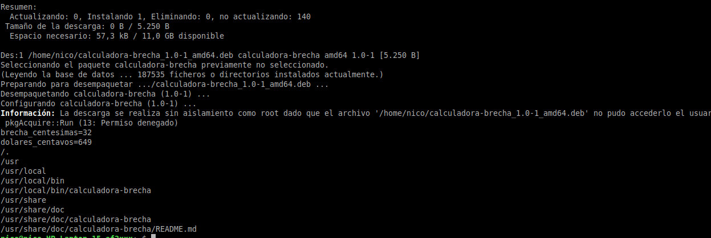

# Procedimiento

Este documento registra paso a paso lo que fuimos haciendo, con las capturas que
verifican cada resultado. Está pensado para leerse en orden.

Las partes siguen la numeración de [`GUIA.md`](GUIA.md), donde están la teoría y los
comandos. Los requisitos del trabajo están en [`CONSIGNA.md`](CONSIGNA.md).

> **Estado:** plantilla. Se completa a medida que hacemos cada parte: pegar las
> capturas en `capturas/` con el nombre indicado, reemplazar los `_(completar)_` y
> borrar esta nota al terminar.

| Parte | Tema | Código |
|---|---|---|
| 1 | Preparar el entorno | — |
| 2 | Mi primer módulo | `part1/module/` |
| 3 | Firmar el módulo | `scripts/crear-clave.sh`, `scripts/firmar.sh` |
| 4 | Nuestro propio módulo | `part1/equipo/` |
| 5 | Los módulos de cada máquina | `scripts/modulos.sh`, `salidas/` |
| 6 | Syscalls y file descriptors | `part1/syscalls/` |
| 7 | Segmentation fault | `part1/segfault/` |
| 8 | Secure Boot y el parche de Microsoft | — |
| 9 | Desafío #2 | — |
| 10 | Desafío #1 | `desafio1/hola/` |

---

# Parte 1: preparar el entorno

```bash
sudo apt update
sudo apt-get install build-essential checkinstall bison flex libncurses-dev \
     libssl-dev libelf-dev bc linux-source linux-headers-$(uname -r) strace git
```


| Dato | Valor |
|---|---|
| Distribución | _(completar, ej. Ubuntu 26.04)_ |
| Kernel (`uname -r`) | _(completar, ej. 7.0.0-29-generic)_ |
| gcc | _(completar, ej. 15.2.0)_ |
| Secure Boot | _(enabled / disabled)_ |
| Lockdown | _(none / integrity)_ |

---

# Parte 2: mi primer módulo

## 2.1 Compilación


_(completar: qué archivos generó y las advertencias que aparecieron)_

## 2.2 Carga


_(completar: los mensajes de dmesg y la línea de /proc/modules, explicando cada campo)_

## 2.3 Descarga


## 2.4 modinfo (pregunta 1)


**¿Qué diferencias se pueden observar entre los dos `modinfo`?**

_(completar con la tabla de la Parte 2.5 de la guía y los valores reales)_

---

# Parte 3: firmar el módulo (preguntas 8 y 10)

## 3.1 Clave y registro en la MOK


## 3.2 Módulo firmado


**¿Se animan a firmar un módulo y documentar el proceso?**

_(completar: los pasos que hicimos, qué muestra modinfo antes y después, y cómo cambió
el taint de (OE) a (O))_

## 3.3 En la máquina de un compañero


**¿Qué pasa si mi compañero con Secure Boot habilitado intenta cargar un módulo firmado
por mí?**

_(completar)_

---

# Parte 4: nuestro propio módulo (pregunta 9)


_(completar: el hostname que aparece en dmesg en cada máquina)_

---

# Parte 5: los módulos de cada máquina (preguntas 2, 3 y 4)

## 5.1 Cargados y disponibles


| Integrante | Equipo | Kernel | Cargados | Disponibles | No cargados |
|---|---|---|---|---|---|
| Nicolás | | | | | |
| Santiago | | | | | |
| Ignacio | | | | | |

Diff entre las máquinas (archivos en `salidas/`):

```diff
(completar: pegar la parte relevante de diff salidas/cargados-A.txt salidas/cargados-B.txt)
```

**¿Qué drivers/módulos están cargados en sus PC? Expliquen las diferencias.**

_(completar)_

**¿Cuáles no están cargados pero están disponibles? ¿Qué pasa cuando el driver de un
dispositivo no está disponible?**

_(completar)_

## 5.2 Drivers de cada dispositivo


## 5.3 hwinfo y hw-probe


URL de linux-hardware.org: _(completar)_

---

# Parte 6: syscalls y file descriptors (preguntas 5 y 6)

## 6.1 strace del hello world


**¿Cómo puede ver una lista de las llamadas al sistema que realiza un simple hello world
en C?**

_(completar)_

## 6.2 copiar_archivo


## 6.3 File descriptors


## 6.4 Módulo vs. programa

**¿Qué diferencia existe entre un módulo y un programa?**

_(completar)_

---

# Parte 7: segmentation fault (pregunta 7)


**¿Qué es un segmentation fault? ¿Cómo lo maneja el kernel y cómo lo hace un programa?**

_(completar)_

---

# Parte 8: Secure Boot y el parche de Microsoft (pregunta 11)

1. **¿Cuál fue la consecuencia principal del parche de Microsoft sobre GRUB en sistemas
   con arranque dual?** _(completar)_
2. **¿Qué implicancia tiene desactivar Secure Boot como solución?** _(completar)_
3. **¿Cuál es el propósito principal del Secure Boot?** _(completar)_

---

# Parte 9: Desafío #2


- **¿Cómo empiezan y terminan unos y otros?** _(completar)_
- **¿Qué funciones tiene disponible un programa y cuáles un módulo?** _(completar)_
- **Espacio de usuario, espacio del kernel y espacio de datos.** _(completar)_
- **Drivers. Contenido de `/dev`.** _(completar)_

---

# Parte 10: Desafío #1





- **¿Qué es checkinstall y para qué sirve?** _(completar)_
- **Paquete del stack frame en dos máquinas.** _(completar)_
- **Evitar cargar módulos sin firmar y evitar rootkits.** _(completar)_
- **¿Qué herramientas conocen? ¿Qué técnicas de seguridad incorpora el kernel?**
  _(completar)_

---

# Conclusiones

_(completar)_
